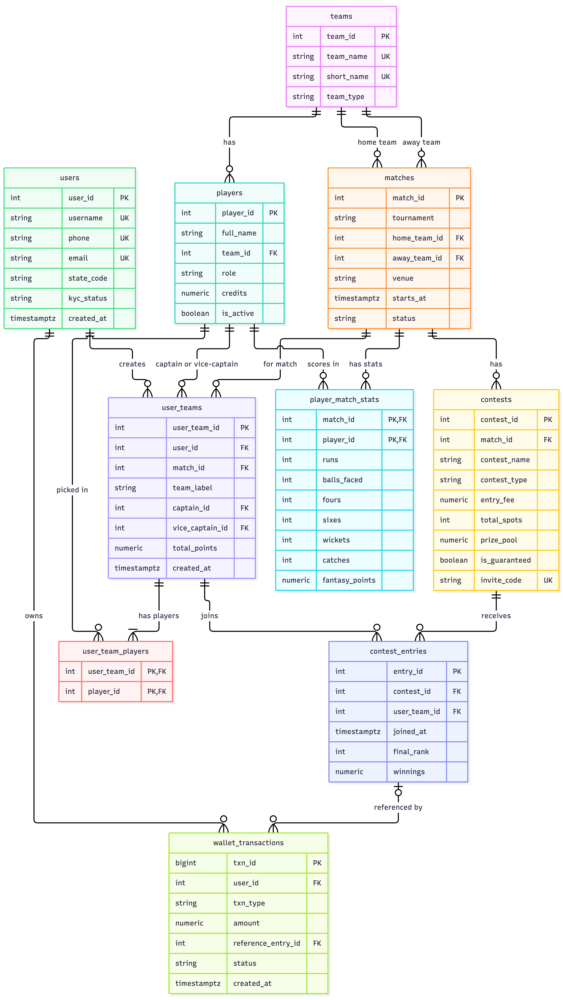
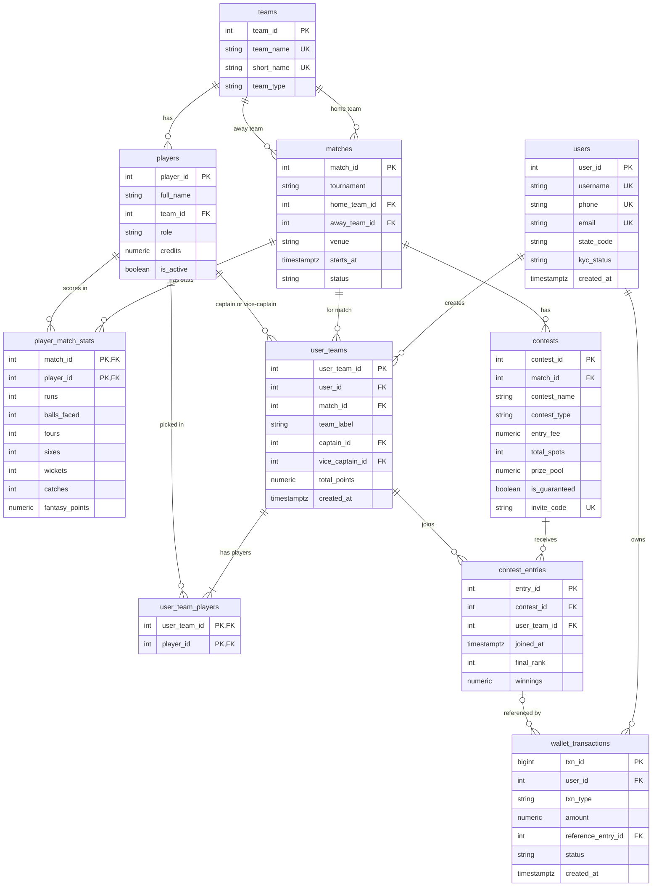

# Phase 2: Schema Design

Team T0140 | Section D
Swastik Mishra (Group Lead), Tanishkka, Abhijeet Saini, Kunal Agrawal

Database: PostgreSQL 16, schema `dream11`. Files: `sql/01_schema.sql` (10 tables), `sql/02_load_data.sql` (10 CSV files).

## 1. Tables aur load order

Parent tables pehle, child tables baad mein load hote hain, taaki foreign keys fail na hon.

| Order | Table | Rows loaded |
|---|---|---|
| 1 | teams | 18 |
| 2 | players | 450 |
| 3 | matches | 212 |
| 4 | users | 50,000 |
| 5 | player_match_stats | 4,444 |
| 6 | user_teams | 39,975 |
| 7 | user_team_players | 439,925 |
| 8 | contests | 2,544 |
| 9 | contest_entries | 42,746 |
| 10 | wallet_transactions | 118,343 |

Saari 10 files bina kisi error ke load hui, matlab humare koi bhi constraint seed data ko reject nahi karta.

## 2. Data dictionary

### 1. teams
| Column | Type | Constraint | Why |
|---|---|---|---|
| team_id | INT | PRIMARY KEY | Har team ki unique pehchaan |
| team_name | TEXT | NOT NULL, UNIQUE | Ek hi naam ki do teams nahi ho sakti |
| short_name | VARCHAR(5) | NOT NULL, UNIQUE, CHECK 2 se 5 capital letters | CSK, MI jaisa chhota code, queries mein fixture dikhane ke kaam aata hai |
| team_type | TEXT | NOT NULL, CHECK IN (FRANCHISE, INTERNATIONAL) | Data mein sirf yahi 2 type hain (10 franchise, 8 international) |

### 2. players
| Column | Type | Constraint | Why |
|---|---|---|---|
| player_id | INT | PRIMARY KEY | Har player ki unique pehchaan |
| full_name | TEXT | NOT NULL | Player ka naam hamesha chahiye |
| team_id | INT | NOT NULL, FK teams(team_id) ON DELETE RESTRICT | Har player kisi team ka hai. Team delete hone pe players gayab na hon, isliye RESTRICT |
| role | TEXT | NOT NULL, CHECK IN (WK, BAT, AR, BOWL) | Data mein sirf 4 roles hain |
| credits | NUMERIC(3,1) | NOT NULL, CHECK BETWEEN 5 AND 12 | Credits decimal hote hain (jaise 8.5), data 6.5 se 10.5 ke beech hai |
| is_active | BOOLEAN | NOT NULL, DEFAULT TRUE | Yes/no wali value, isliye BOOLEAN |

### 3. matches
| Column | Type | Constraint | Why |
|---|---|---|---|
| match_id | INT | PRIMARY KEY | Har match ki unique pehchaan |
| tournament | TEXT | NOT NULL | Match kis tournament ka hai (jaise IPL 2026) |
| home_team_id | INT | NOT NULL, FK teams(team_id) ON DELETE RESTRICT | Home team, teams table se judi hai |
| away_team_id | INT | NOT NULL, FK teams(team_id) ON DELETE RESTRICT | Away team, teams table se judi hai |
| venue | TEXT | NOT NULL | Match ki jagah |
| starts_at | TIMESTAMPTZ | NOT NULL | Time zone ke saath start time (data mein +05:30 hai) |
| status | TEXT | NOT NULL, CHECK IN (UPCOMING, LIVE, COMPLETED, ABANDONED) | Data mein 4 status hain, LIVE sirf 1 match mein |

Table-level CHECK: `home_team_id <> away_team_id`, kyunki ek team khud ke khilaf nahi khel sakti.

### 4. users
| Column | Type | Constraint | Why |
|---|---|---|---|
| user_id | INT | PRIMARY KEY | Har user ki unique pehchaan |
| username | TEXT | NOT NULL, UNIQUE, CHECK sirf letters, digits, underscore | Har user ka alag handle, format fixed |
| phone | VARCHAR(10) | NOT NULL, UNIQUE, CHECK 10 digits | Login mobile se hota hai (R23). Text rakha kyunki query string se compare karti hai |
| email | TEXT | UNIQUE, CHECK '@' hona chahiye, NULL allowed | 19,935 users ka email khaali hai, isliye NOT NULL nahi lagaya |
| state_code | CHAR(2) | NOT NULL, CHECK 2 capital letters | State ka code (AP, AS, ...), compliance check mein kaam aata hai |
| kyc_status | TEXT | NOT NULL, CHECK IN (PENDING, VERIFIED, REJECTED) | Data mein sirf 3 status hain |
| created_at | TIMESTAMPTZ | NOT NULL | Account kab bana, time zone ke saath |

### 5. player_match_stats
| Column | Type | Constraint | Why |
|---|---|---|---|
| match_id | INT | PK (composite), FK matches(match_id) RESTRICT | Kis match ki stats hain |
| player_id | INT | PK (composite), FK players(player_id) RESTRICT | Kis player ki stats hain. Ek player ek match mein ek hi baar |
| runs | SMALLINT | NOT NULL, CHECK >= 0 | Chhota whole number, negative nahi ho sakta |
| balls_faced | SMALLINT | NOT NULL, CHECK >= 0 | Chhota whole number |
| fours | SMALLINT | NOT NULL, CHECK >= 0 | Chhota whole number |
| sixes | SMALLINT | NOT NULL, CHECK >= 0 | Chhota whole number |
| wickets | SMALLINT | NOT NULL, CHECK BETWEEN 0 AND 10 | Ek innings mein max 10 wickets |
| catches | SMALLINT | NOT NULL, CHECK >= 0 | Chhota whole number |
| fantasy_points | NUMERIC(6,1) | NOT NULL | Decimal points (jaise 58.0), runs/wickets se nikle hue |

### 6. user_teams
| Column | Type | Constraint | Why |
|---|---|---|---|
| user_team_id | INT | PRIMARY KEY | Team ki unique pehchaan |
| user_id | INT | NOT NULL, FK users(user_id) RESTRICT | Team kis user ki hai |
| match_id | INT | NOT NULL, FK matches(match_id) RESTRICT | Team kis match ke liye hai |
| team_label | VARCHAR(3) | NOT NULL, CHECK format T1, T2, ... | User ki teams ka naam |
| captain_id | INT | NOT NULL, FK players(player_id) RESTRICT | Captain (2x points) |
| vice_captain_id | INT | NOT NULL, FK players(player_id) RESTRICT | Vice-captain (1.5x points) |
| total_points | NUMERIC(7,1) | NULL allowed | Match ka result aane se pehle khaali rehta hai |
| created_at | TIMESTAMPTZ | NOT NULL | Team kab banayi, time zone ke saath |

Table-level: `UNIQUE (user_id, match_id, team_label)`, `CHECK (captain_id <> vice_captain_id)`.

### 7. user_team_players
| Column | Type | Constraint | Why |
|---|---|---|---|
| user_team_id | INT | PK (composite), FK user_teams(user_team_id) CASCADE | Team ka hissa hai, team delete to rows bhi |
| player_id | INT | PK (composite), FK players(player_id) RESTRICT | Ek player ek team mein ek hi baar |

### 8. contests
| Column | Type | Constraint | Why |
|---|---|---|---|
| contest_id | INT | PRIMARY KEY | Contest ki unique pehchaan |
| match_id | INT | NOT NULL, FK matches(match_id) RESTRICT | Contest kis match ka hai |
| contest_name | TEXT | NOT NULL | Contest ka naam |
| contest_type | TEXT | NOT NULL, CHECK IN (MEGA, SMALL, HEAD_TO_HEAD, PRIVATE) | Contest ke fixed types |
| entry_fee | NUMERIC(8,2) | NOT NULL, CHECK >= 0 | Paise ke liye NUMERIC. 0 matlab free contest |
| total_spots | INT | NOT NULL, CHECK > 0 | Kitne log join kar sakte hain |
| prize_pool | NUMERIC(12,2) | NOT NULL, CHECK >= 0 | Total prize money |
| is_guaranteed | BOOLEAN | NOT NULL | Yes/no wali value |
| invite_code | VARCHAR(20) | UNIQUE, NULL allowed | Sirf private contest ka code, baaki ka khaali |

Table-level: head-to-head mein `total_spots = 2`, aur `contest_type = 'PRIVATE'` tabhi jab `invite_code` ho.

### 9. contest_entries
| Column | Type | Constraint | Why |
|---|---|---|---|
| entry_id | INT | PRIMARY KEY | Entry ki unique pehchaan |
| contest_id | INT | NOT NULL, FK contests(contest_id) RESTRICT | Kaunse contest mein |
| user_team_id | INT | NOT NULL, FK user_teams(user_team_id) RESTRICT | Kaunsi team join hui |
| joined_at | TIMESTAMPTZ | NOT NULL | Kab join kiya, time zone ke saath |
| final_rank | INT | CHECK > 0, NULL allowed | Result aane se pehle khaali |
| winnings | NUMERIC(12,2) | NOT NULL, DEFAULT 0, CHECK >= 0 | Jeeti hui raqam, nahi jeeta to 0 |

Table-level: `UNIQUE (contest_id, user_team_id)`, ek team ek contest mein ek hi baar.

### 10. wallet_transactions
| Column | Type | Constraint | Why |
|---|---|---|---|
| txn_id | BIGINT | PRIMARY KEY | Har transaction ki unique pehchaan, table sabse bada hai isliye BIGINT |
| user_id | INT | NOT NULL, FK users(user_id) ON DELETE RESTRICT | Transaction kis user ki hai. Paise ki history kabhi delete nahi honi chahiye, isliye RESTRICT |
| txn_type | TEXT | NOT NULL, CHECK IN (DEPOSIT, ENTRY_FEE, WINNINGS, REFUND, BONUS, WITHDRAWAL) | Data mein sirf 6 types hain |
| amount | NUMERIC(12,2) | NOT NULL, CHECK amount > 0 | Paise ke liye NUMERIC (FLOAT nahi), data 25.00 se 33320.00 ke beech hai |
| reference_entry_id | INT | FK contest_entries(entry_id) ON DELETE RESTRICT, NULL allowed, table-level CHECK (neeche dekho) | ENTRY_FEE, REFUND, WINNINGS ke liye zaroori (ye hamesha kisi contest entry se jude hain). DEPOSIT, BONUS, WITHDRAWAL (63,000 rows) ke liye khaali, isliye NULL allowed |
| status | TEXT | NOT NULL, CHECK IN (SUCCESS, PENDING, FAILED) | Data mein sirf 3 status hain |
| created_at | TIMESTAMPTZ | NOT NULL | Transaction ka time, time zone ke saath |

Table-level CHECK: `(txn_type IN ('ENTRY_FEE', 'REFUND', 'WINNINGS')) = (reference_entry_id IS NOT NULL)`. Matlab in 3 types ke liye `reference_entry_id` zaroor ho, aur baaki 3 types ke liye khaali ho. Data mein ye bilkul sahi baithta hai: ENTRY_FEE 42,554, REFUND 487 aur WINNINGS 12,302 rows sabke paas reference hai, aur BONUS 8,000, DEPOSIT 45,000 aur WITHDRAWAL 10,000 rows ke paas koi reference nahi.


Total mila ke schema mein 31 CHECK constraints hain (column-level aur table-level dono), jabki kam se kam 12 chahiye the.

## 3. ER diagram



Mermaid code:



## 4. Relationships aur cardinality

| Relationship | Type | Kaise implement hua |
|---|---|---|
| teams se players | 1:N | `players.team_id` FK. Ek team ke kai players, ek player ek hi team ka |
| teams se matches | 1:N (do baar) | `home_team_id` aur `away_team_id`, dono FK to teams |
| matches se player_match_stats | 1:N | `match_id` FK |
| players se player_match_stats | 1:N | `player_id` FK |
| matches aur players | M:N | `player_match_stats` junction table hai, PK `(match_id, player_id)` |
| users se user_teams | 1:N | `user_id` FK |
| matches se user_teams | 1:N | `match_id` FK |
| players se user_teams | 1:N (do baar) | `captain_id` aur `vice_captain_id`, dono FK to players |
| user_teams aur players | M:N | `user_team_players` junction table hai, PK `(user_team_id, player_id)` |
| matches se contests | 1:N | `contests.match_id` FK |
| contests aur user_teams | M:N | `contest_entries` junction table hai, `UNIQUE (contest_id, user_team_id)` |
| users se wallet_transactions | 1:N | `user_id` FK |
| contest_entries se wallet_transactions | 1:N, optional | `reference_entry_id` FK, NULL allowed (deposit, bonus, withdrawal ke liye) |

Koi 1:1 relationship nahi hai.

## 5. Primary keys, foreign keys aur ON DELETE rules

- **Single-column PK:** teams, players, matches, users, user_teams, contests, contest_entries, wallet_transactions.
- **Composite PK:** `player_match_stats (match_id, player_id)` aur `user_team_players (user_team_id, player_id)`.
- **Ek team ek contest mein do baar nahi judti:** `UNIQUE (contest_id, user_team_id)` in `contest_entries`.
- **invite_code:** UNIQUE hai par NULL allowed, kyunki sirf private contests ke paas code hota hai (PostgreSQL UNIQUE mein kai NULL allow karta hai).

**ON DELETE kyun:**

| Foreign key | Rule | Reason |
|---|---|---|
| `user_team_players.user_team_id` to user_teams | CASCADE | Ye team ka hi hissa hai. Team delete hone par uske player rows ka koi matlab nahi bachta |
| `wallet_transactions.user_id` aur `reference_entry_id` | RESTRICT | Paise ki history audit ke liye hamesha rehni chahiye |
| `contest_entries` ke FKs | RESTRICT | Entry delete hone se winnings aur wallet ka record toot jayega |
| `user_teams` ke FKs | RESTRICT | Contest entries aur points inpe depend karte hain |
| Baaki sab FK (players, matches, contests, stats) | RESTRICT | Parent delete karne se history khoni nahi chahiye, pehle child rows saaf karni padengi |

SET NULL kahin use nahi kiya, kyunki saare FK columns NOT NULL hain (sirf `reference_entry_id` nullable hai, par wo kisi parent ke delete par NULL nahi hona chahiye, nahi to wallet ki audit trail toot jati).

## 6. Game rules: CHECK se kaunse ho sakte hain

| Rule | CHECK se ho sakta hai? | Kaise |
|---|---|---|
| Captain aur vice-captain alag | Haan | `CHECK (captain_id <> vice_captain_id)` (lagaya hai) |
| Home team aur away team alag | Haan | `CHECK (home_team_id <> away_team_id)` (lagaya hai) |
| Head-to-head mein 2 spots | Haan | CHECK on `contest_type` aur `total_spots` (lagaya hai) |
| Private contest ka invite code hona | Haan | `contest_type = 'PRIVATE'` tabhi jab `invite_code` ho (lagaya hai) |
| Exactly 11 players | Nahi | Ye kai rows (`user_team_players`) ki ginti hai, CHECK sirf ek row dekhta hai. Trigger ya application logic chahiye |
| 100 credits ke andar | Nahi | Kai rows ka sum hai, trigger chahiye |
| Ek side se max 7 players | Nahi | Players ki team dusre table se aati hai, trigger chahiye |
| Players us match ki 2 teams se | Nahi | Teen tables (user_teams, matches, players) ka cross-check, trigger chahiye |
| Match start ke baad team nahi banti | Nahi | `user_teams.created_at` aur `matches.starts_at` alag tables mein hain, trigger chahiye |
| Captain aur vice-captain team ke 11 mein ho | Sirf composite FK se | `FOREIGN KEY (user_team_id, captain_id) REFERENCES user_team_players` DEFERRABLE se ho sakta hai, par abhi implement nahi kiya |

Humne in cross-row rules ke liye trigger nahi lagaye kyunki Phase 2 mein sirf PK, FK, UNIQUE, NOT NULL aur CHECK allowed hain. Saath hi trigger har team save (W01) aur contest join (W02) ko slow karta, jabki P3 mein inhe lag-free rakhna hai. Ye rules abhi integrity checks (section 11) aur fair-play queries (R06) se verify hote hain.

## 7. Functional dependencies aur normal form

| Table | Functional dependencies | Normal form |
|---|---|---|
| teams | `team_id -> team_name, short_name, team_type`. `team_name` aur `short_name` bhi candidate keys hain | BCNF (har determinant ek candidate key hai) |
| players | `player_id -> full_name, team_id, role, credits, is_active` | BCNF |
| matches | `match_id -> tournament, home_team_id, away_team_id, venue, starts_at, status` | BCNF |
| users | `user_id -> username, phone, email, state_code, kyc_status, created_at`. `username`, `phone`, `email` candidate keys hain | BCNF |
| player_match_stats | `(match_id, player_id) -> runs, balls_faced, fours, sixes, wickets, catches, fantasy_points` | BCNF, par `fantasy_points` derived hai (section 8) |
| user_teams | `user_team_id -> user_id, match_id, team_label, captain_id, vice_captain_id, total_points, created_at`. `(user_id, match_id, team_label)` bhi candidate key hai | BCNF, par `total_points` derived hai (section 8) |
| user_team_players | Sirf key columns hain, koi non-key attribute nahi | BCNF (trivially) |
| contests | `contest_id -> match_id, contest_name, contest_type, entry_fee, total_spots, prize_pool, is_guaranteed, invite_code`. `invite_code` candidate key hai | BCNF, par `prize_pool` derived lagta hai (section 8) |
| contest_entries | `entry_id -> contest_id, user_team_id, joined_at, final_rank, winnings`. `(contest_id, user_team_id)` candidate key hai | BCNF |
| wallet_transactions | `txn_id -> user_id, txn_type, amount, reference_entry_id, status, created_at` | BCNF |

Har table ki dependencies sirf primary key ya candidate key pe tiki hain, isliye 3NF aur BCNF dono hain (derived columns ko chhodke).

## 8. Derived (redundant) columns

| Column | Kisse nikalta hai | Rakhna theek hai? |
|---|---|---|
| `player_match_stats.fantasy_points` | Runs, fours, sixes, wickets, catches wagairah se scoring rules lagake | Haan. Points ka formula badal sakta hai, to purane matches ke points ko "freeze" karke rakhna zaroori hai. Roz roz recompute karna bhi mehnga hai. Technically ye 3NF todta hai (stats se points nikalte hain), par ye jaan boojhke rakha gaya denormalization hai |
| `user_teams.total_points` | Team ke har player ke fantasy_points ko captain (2x) aur vice-captain (1.5x) se multiply karke jodna | Haan. Leaderboard (R05) isi se rank karta hai, har baar sab players ka sum nikalna slow hoga. Points engine (W04) isse dobara calculate karta hai. Risk: stats badle aur total_points update na ho, to dono mismatch ho jayenge |
| `contests.prize_pool` | `entry_fee x total_spots` ka ek hissa. Do examples mein 85% mila (83300 = 0.85 x 49 x 2000, aur 2125 = 0.85 x 25 x 100) | TODO: Abhijeet ke bonus check ka result yahan likho (ratio kitne contests mein 0.85 hai). Guaranteed contests mein prize pool fee se alag fixed ho sakta hai, isliye rakhna zaroori hai |
| `contest_entries.final_rank`, `winnings` | Contest ke andar `total_points` ka rank, aur rank se prize | Haan, kyunki result match ke baad ek baar final hota hai. Isko dobara compute karna slow aur risky hai |

## 9. Indexes jo abhi maujood hain

Is phase mein humne koi extra index nahi banaya. PostgreSQL PRIMARY KEY aur UNIQUE ke liye khud index banata hai:

| Table | Indexed columns (PK ya UNIQUE se) |
|---|---|
| teams | team_id, team_name, short_name |
| players | player_id |
| matches | match_id |
| users | user_id, username, phone, email |
| player_match_stats | (match_id, player_id) |
| user_teams | user_team_id, (user_id, match_id, team_label) |
| user_team_players | (user_team_id, player_id) |
| contests | contest_id, invite_code |
| contest_entries | entry_id, (contest_id, user_team_id) |
| wallet_transactions | txn_id |

Foreign key columns (jaise `wallet_transactions.user_id`, `user_teams.match_id`, `contest_entries.contest_id`) pe PostgreSQL index **nahi** banata. Isi wajah se baseline mein kai queries slow hongi, aur ye Phase 4 mein theek karenge.

TODO: ye query chalake exact output yahan paste karo:
```bash
psql dream11_db -c "SELECT tablename, indexname FROM pg_indexes WHERE schemaname='dream11' ORDER BY tablename, indexname;"
```

## 10. Data load

Command (project ke root folder se):
```bash
psql dream11_db -f sql/01_schema.sql
psql dream11_db -f sql/02_load_data.sql
```
Saari 10 files bina error ke load hui, aur row counts section 1 ki table se match karte hain.

## 11. Integrity checks

TODO: Abhijeet ke result table se yahan bharo (7 checks, expected aur actual dono).

| # | Check | Expected | Actual result | Pass? |
|---|---|---|---|---|
| 0 | Row counts (10 tables) | 18, 450, 212, 50000, 4444, 39975, 439925, 2544, 42746, 118343 | | |
| 1 | Har team mein exactly 11 players | 39975 teams mein 11 | | |
| 2 | Players us match ki 2 teams se | 0 bad rows | | |
| 3 | Team match start ke baad nahi bani | 0 bad rows | | |
| 4 | Har paid entry ka exactly 1 debit | 42746 entries mein 1 debit | | |
| 5 | Captain/vice-captain team ke players mein | 0 bad rows | | |
| 6 | Entry ki team aur contest ka match same | 0 bad rows | | |
| 7 | Koi contest overfilled nahi | 0 bad contests | | |

## 12. Data mein mili problems aur observations

| # | Observation | Detail |
|---|---|---|
| 1 | `users.email` 19,935 rows mein khaali hai | Isliye `email` NOT NULL nahi hai, par UNIQUE hai |
| 2 | `matches.status` mein `LIVE` bhi hai | Sirf 1 match LIVE hai (baaki 202 COMPLETED, 6 UPCOMING, 3 ABANDONED). Statement mein bataya nahi tha |
| 3 | `user_team_players` mein 200 rows zyada hain | 39,975 teams x 11 = 439,725, par file mein 439,925 rows hain. TODO: Abhijeet ke check 1 ka result likho (kitni teams mein 11 players nahi hain) |
| 4 | Entry fee debit aur entries ka farak | wallet mein ENTRY_FEE rows 42,554 hain, jabki contest entries 42,746 hain. Matlab kam se kam 192 entries ka debit nahi hai. TODO: Abhijeet ke check 4 ka result likho |
| 5 | 63,000 wallet rows mein `reference_entry_id` NULL hai | DEPOSIT, BONUS, WITHDRAWAL kisi entry se nahi jude, isliye ye sahi hai. Par isi ki wajah se `NOT IN` wali query R13 galat answer degi (Phase 4 mein dekhenge) |
| 6 | `user_teams.total_points` 2,098 teams ka khaali hai | Jahan match ka result abhi nahi aaya |
| 7 | `contest_entries.final_rank` 2,125 entries ka khaali hai | Jahan contest ka result abhi nahi aaya |
| 8 | Wallet mein FAILED (1,521) aur PENDING (100) transactions hain | Balance sirf SUCCESS (116,722) rows se nikalna chahiye |
| 9 | Koi free contest nahi hai | `entry_fee` ki range 25.00 se 1000.00 hai |

Koi bhi load error nahi aaya, matlab humne jo constraints lagaye wo asli data ke hisaab se sahi nikle. Kuch constraints ko pehle draft mein galat guess kiya tha (jaise `NATIONAL` ki jagah asli value `INTERNATIONAL` hai, aur `matches.status` mein `LIVE` chhut gaya tha), jo data dekhne ke baad theek kiye gaye.